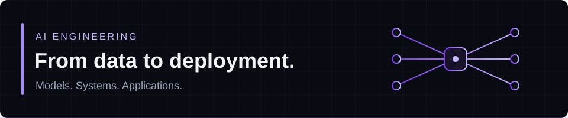

# Anass Erfoudi — AI Engineer in the Making

I'm an **Artificial Intelligence Master's student** in Casablanca, Morocco, building end-to-end AI applications—from data pipelines and models to APIs and interfaces. I focus on computer vision, RAG and LLM systems, and MLOps.

**Available for a 4–6 month PFE internship starting February 20, 2027.**

**[Portfolio](https://portfolio-six-vert-17.vercel.app/en) · [LinkedIn](https://linkedin.com/in/anass-erfoudi-571762274) · [Email](mailto:anasserfoudi@gmail.com)**

*Étudiant en Master d'intelligence artificielle à Casablanca, je développe des applications IA de bout en bout et recherche un stage PFE dès février 2027.*
